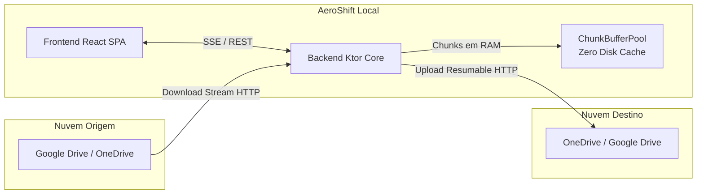

# 🚀 AeroShift

> **Migração e Sincronização Multi-Cloud de Alta Performance sem Armazenamento Local (Zero-Disk Cache)**

O **AeroShift** é uma aplicação moderna de sincronização e migração direta entre provedores de nuvem (**Google Drive** e **Microsoft OneDrive**). Projetada para usuários finais e ambientes profissionais que exigem rapidez, segurança e eficiência, o AeroShift realiza a ponte de dados diretamente na memória RAM — **sem gravar nenhum arquivo no disco local** durante o processo.

---

## 🌟 Principais Destaques

- **🧠 Processamento In-Memory (Zero Disk Cache):** O fluxo de dados conecta o `InputStream` da origem diretamente ao `OutputStream` do destino através de buffers circulares em RAM. Seus dados nunca tocam o SSD/HDD da máquina local.
- **⚡ Resumable Uploads & Chunks Inteligentes:** Divide grandes arquivos em blocos (chunks de 8 MB a 10 MB) com sessões de upload oficiais dos provedores (Google Drive Resumable Upload e Microsoft Graph Upload Session).
- **🛡️ Resiliência Extrema & Auto-Recuperação:** 
  - Tratamento avançado de quedas de rede, instabilidades de DNS (`UnresolvedAddressException`), timeouts e limites de taxa (`HTTP 429 Too Many Requests`).
  - Reconexão com Exponential Backoff e sincronização dinâmica de offsets remotos: se uma parte do upload falhar, o pipeline retoma exatamente de onde o provedor parou, sem reiniciar o arquivo do zero.
- **🎯 Controle de Sequência de Fila:** Permite escolher como os arquivos serão migrados:
  - ⚡ **Menores primeiro (Rápido):** Garante que milhares de arquivos leves sejam transferidos de imediato.
  - 🐘 **Maiores primeiro:** Prioriza grandes arquivos pesados (vídeos, ISOs, zips).
  - 📁 **Ordem da pasta:** Respeita a ordem natural da árvore de diretórios.
- **🔍 Pesquisa Instantânea & Seleção por Checkboxes:** Explorador de arquivos ágil com busca em tempo real, seleção por checkboxes na 1ª coluna e seleção em lote no cabeçalho.
- **📊 Telemetria em Tempo Real (SSE):** Acompanhamento segundo a segundo com Server-Sent Events exibindo porcentagem de progresso, bytes transferidos, velocidade (MB/s), ETA estimado e relatório de arquivos ignorados ou com falhas.
- **🔐 Fluxo OAuth 2.0 PKCE Seguro:** Autenticação direta com Google e Microsoft sem expor segredos de aplicação cliente.

---

## 🏗️ Arquitetura do Sistema

O projeto é estruturado como um monorepo dividido em duas camadas desacopladas:

```
AeroShift/
├── backend/               # Servidor Kotlin + Ktor + Coroutines
│   ├── src/main/kotlin/   # Clean Architecture (Domain, Engine, Connectors, Routes)
│   └── build.gradle.kts   # Dependências Gradle (JVM 17+)
├── frontend/              # SPA React 19 + TypeScript + Vite 8
│   ├── src/               # Componentes, estilos Glassmorphism e lógica de estado
│   └── package.json       # Dependências npm
└── README.md              # Documentação principal do projeto
```

### Diagrama de Fluxo de Dados



---

## 📋 Pré-requisitos

Antes de iniciar, certifique-se de possuir em seu ambiente:

1. **Java JDK 17+** (OpenJDK, Temurin ou GraalVM).
2. **Node.js 18+** e **npm**.
3. **Credenciais OAuth dos Provedores:**
   - **Google Cloud Console:** Projeto com a **Google Drive API** ativada e um OAuth Client ID do tipo *Desktop App*.
   - **Microsoft Entra ID (Azure Portal):** Aplicativo registrado com suporte a contas pessoais/corporativas, com as permissões de escopo `Files.ReadWrite` e `offline_access`.

---

## ⚙️ Configuração das Variáveis de Ambiente

No terminal em que for executar o Backend, defina as credenciais OAuth:

### macOS / Linux (bash/zsh)
```bash
export GOOGLE_CLIENT_ID="seu-google-client-id.apps.googleusercontent.com"
export GOOGLE_CLIENT_SECRET="seu-google-client-secret" # opcional para apps desktop PKCE

export MICROSOFT_CLIENT_ID="seu-microsoft-client-id"
export MICROSOFT_CLIENT_SECRET="seu-microsoft-client-secret" # opcional para clientes públicos
```

### Windows (PowerShell)
```powershell
$env:GOOGLE_CLIENT_ID="seu-google-client-id.apps.googleusercontent.com"
$env:GOOGLE_CLIENT_SECRET="seu-google-client-secret"

$env:MICROSOFT_CLIENT_ID="seu-microsoft-client-id"
$env:MICROSOFT_CLIENT_SECRET="seu-microsoft-client-secret"
```

> 💡 **Nota sobre URIs de Redirecionamento (Redirect URIs):**  
> Cadastre as seguintes URLs nos consoles de desenvolvedor do Google e da Microsoft:  
> - Google: `http://localhost:8080/auth/google/callback`  
> - Microsoft: `http://localhost:8080/auth/microsoft/callback`

---

## 🚀 Como Executar

### 1. Inicializando o Backend (Porta 8080)

Em uma janela de terminal:
```bash
cd backend
./gradlew run
```
*(No macOS com MacPorts ou Homebrew, você também pode usar `gradle run`)*

O servidor iniciará em `http://localhost:8080`.

### 2. Inicializando o Frontend (Porta 5173)

Em outra janela de terminal:
```bash
cd frontend
npm install
npm run dev
```

Abra o seu navegador em:
```
http://localhost:5173
```

---

## 📖 Como Usar o AeroShift

1. **Conectar Provedores:** Na tela inicial, clique em **Conectar** para autenticar suas contas do Google Drive e OneDrive.
2. **Definir Origem e Destino:** O botão central de alternância (`⇄`) permite inverter o sentido da migração a qualquer momento.
3. **Explorar e Selecionar Arquivos:**
   - Use o campo de **Pesquisa** (`🔍`) para encontrar arquivos rapidamente.
   - Marque os **Checkboxes** dos arquivos e pastas desejados na coluna esquerda, ou selecione tudo de uma pasta no cabeçalho.
   - No painel de destino, navegue até a pasta desejada ou crie uma com o botão **`+ Nova Pasta`**.
4. **Configurar Opções de Transferência:**
   - Ative/desative a opção de ignorar arquivos vazios (0 bytes) ou duplicados (mesmo tamanho e hash).
   - Escolha a **Ordem da fila** (`⚡ Menores primeiro`, `🐘 Maiores primeiro` ou `📁 Ordem da pasta`).
5. **Iniciar Migração:** Clique em **Iniciar Migração**. Acompanhe a velocidade em MB/s, ETA, arquivos concluídos e detalhes de erros na tela de progresso em tempo real!

---

## 🧪 Executando os Testes Automatizados

### Testes do Backend
```bash
cd backend
./gradlew test
```

### Validação de Tipos e Build do Frontend
```bash
cd frontend
npm run build
```

---

## 👤 Autor

**Cesar Farago**  
- **GitHub:** [@cesarfarago](https://github.com/cesarfarago)  
- **Repositório:** [https://github.com/cesarfarago/AeroShift](https://github.com/cesarfarago/AeroShift)

---

## 📄 Licença & Direitos

Copyright (c) 2026 **Cesar Farago**. Todos os direitos reservados.  
Distribuído sob a licença MIT. Consulte o arquivo de licença para mais detalhes.
